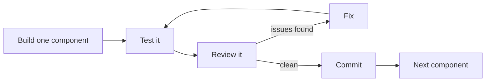

# Contributing

## Documentation style

All docs in this repo use **simple technical English**:

- Short sentences. One idea per sentence.
- Common words. Write "use", not "leverage". Write "check", not "validate the integrity of".
- Keep technical terms as they are (outbox, ledger, idempotency key). Explain a term the first time you use it, or add it to the [glossary](docs/GLOSSARY.md).
- Use tables and lists for rules, options and steps. Use short paragraphs for reasons.
- Say *why*, not only *what*. Every rule should have a reason a new team member can understand.
- Draw it when a picture is clearer: Mermaid for flows, states and structure.
- Record important decisions as an ADR in [docs/adr](docs/adr/README.md).

## How work is done

Every component goes through the same loop. A component is one small piece that can be tested alone: a library, one use case, one adapter.

1. **Build** the component as its low-level design describes. If the design is wrong, fix the design first.
2. **Test** it: unit tests for rules, integration tests for adapters. The tests must fail before the fix and pass after it.
3. **Review** it against the checklist below, as a critic: look for what is wrong, not for what works. Then plant deliberate bugs: each one must make a test fail. Write the findings in `docs/reviews/`.
4. **Fix** every finding, or record why it stays.
5. **Review again** until a pass finds nothing new.
6. At the end of each milestone, review the whole milestone. At the end of the project, review everything.

### Review checklist

| Area | Questions |
|---|---|
| Correctness | Does it do what the design says? What happens on the unhappy paths? |
| Money | Are all amounts in halalas? Does every posting balance? Can a retry move money twice? Does unexplained money end in suspense? |
| Concurrency | What if two requests, two workers or two fetches run at the same time? What if the process dies between two steps? |
| Gateway | Is every answer one of done, refused or unknown? Is an unknown result ever treated as a failure? Is anything sent twice that could move money twice? |
| Events | Is the handler safe to run twice? Is the event written in the same transaction as the data? |
| Structure | Does the code respect the layers? Is each class in the right package? |
| Naming | Does every name say what the thing is, in the words of the glossary? |
| Security | Who may call this? Can a token or a secret reach the database or the logs? Is anything from the customer's browser trusted? |
| Tests | Is each rule tested where it lives? Are the edge cases covered? |
| Simplicity | Could this be done with less? Would a new engineer understand it in one read? |
| Docs | Do the design, the API description and the glossary still match the code? |

## Code structure

`mizan-app` has four layers. A layer may only use the layers below it in this table.

| Layer | Package | Contains | May use |
|---|---|---|---|
| Adapters | `adapter.in.*`, `adapter.out.*` | Controllers, workers, repositories, gateway clients | application, domain |
| Config | `config` | Spring wiring | everything |
| Application | `application` | Use cases, ports (interfaces), transactions | domain |
| Domain | the `mizan-core` module | The payment, sync, ledger rules, fees, matching | nothing but the JDK |

- Put a business rule in the domain and test it there first.
- A use case that changes something is one class with one public method, `handle`. It is the only place that opens a transaction, and it does so through the `Transactions` port, so the code shows where each transaction begins and ends. A gateway call is never inside one. From Spring a use case may use only `@Service`.
- An adapter never holds a business rule. It translates.
- Architecture tests (ArchUnit) enforce these rules.

## Commits

- Use [Conventional Commits](https://www.conventionalcommits.org/): `feat:`, `fix:`, `docs:`, `test:`, `refactor:`, `build:`, `chore:`, `ci:`.
- Keep each commit small. Each one must build and pass the tests.
- The subject line is in the imperative ("add credit reservation"), at most 72 characters. Use the body to explain why.
- A database change needs a Flyway migration in the same commit.
- A change to an event or an API changes a contract. Update the contract tests and the docs in the same commit.
- Never commit a secret, a real key or a real card number.
