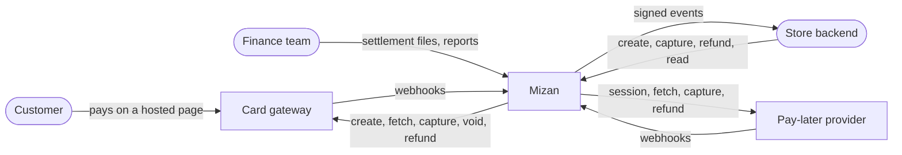

# Mizan

**The payments service of an online store.** Take a payment by card, Apple Pay or pay later; confirm it; give money back; keep the books; and check that the money the gateway paid out is the money the store sold.

*Mizan* (ميزان) is Arabic for a scale. It is a working name.

> **Status:** built, tested and reviewed. Not yet run against a real gateway's test mode, which needs test keys: until then, the [assumptions](docs/DESIGN.md#15-assumptions-to-confirm) about the gateways stay open. See [STATUS.md](docs/plan/STATUS.md).


## The idea in one minute

Payments go wrong in boring ways. A call times out after the card was charged. A webhook comes twice, or never. The customer pays in two tabs. The gateway pays out a little less than expected and nobody notices.

Mizan is built on seven rules that make these cases safe:

| # | Rule |
|---|---|
| R1 | The gateway knows the truth about money. Mizan keeps a copy, and one function, *sync*, updates it |
| R2 | A webhook is a hint, not a fact. Mizan asks the gateway |
| R3 | Mizan chooses the payment's id before the first call, so a lost answer can be looked up |
| R4 | One operation at a time per payment |
| R5 | No gateway call inside a database transaction |
| R6 | Every money fact is posted to the ledger once, with the fact |
| R7 | Money that cannot be explained goes to suspense, and stays visible |

Where Mizan sits:



The rules are not only claimed. A simulator breaks things on purpose, and a [proof run](docs/proof/run-10000-seed-11.md) of 10,000 orders with faults checks the result against the simulator's own record. Every part was also tested with deliberate bugs: a bug is planted, a test must fail.

## Run it

You need Java 21 and Docker.

```bash
./mvnw verify
```

builds everything and runs every test: the rules, the simulator, and the service against a real PostgreSQL in a container.

```bash
./mvnw package -DskipTests && docker compose up --build -d && docker compose run --rm mizan keys create --name=demo --scopes=payments,backoffice
```

starts Mizan with its database and the simulator of both gateways, and prints an API key. The API is on `http://localhost:8080`; its description is at [`/v3/api-docs`](mizan-app/src/main/resources/openapi.yaml).

To see the main flows, `scripts/demo.sh` runs eight of them against the containers and prints what happened. Its output is in [docs/demo](docs/demo/demo-output.txt).

## Documents

| Document | What it is |
|---|---|
| [Mizan in one page](docs/INTERVIEW.md) | The business, the rules, the hard questions and their answers |
| [Design](docs/DESIGN.md) | The high-level design: context, rules, flows, ledger, reconciliation, security, testing |
| [Low-level designs](docs/lld/README.md) | Each part in detail, with every case |
| [Decisions](docs/adr/README.md) | Why each important choice was made |
| [Glossary](docs/GLOSSARY.md) | The words, in English and Arabic |
| [Plan](docs/plan/PLAN.md) and [status](docs/plan/STATUS.md) | The milestones and where the work stands |
| [Reviews](docs/reviews) | What each review found and what was fixed |
| [Proof runs](docs/proof) | The reports of the long proof runs |
| [Contributing](CONTRIBUTING.md) | The style of the docs and the code, and the review checklist |

## Not a real gateway

Mizan is an independent open-source project. It is not made or approved by any payment gateway or pay-later provider. Its simulator follows their public documents and is not their software.

## License

MIT. See [LICENSE](LICENSE).
