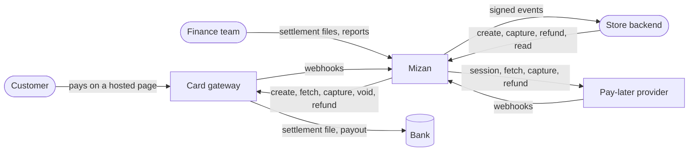
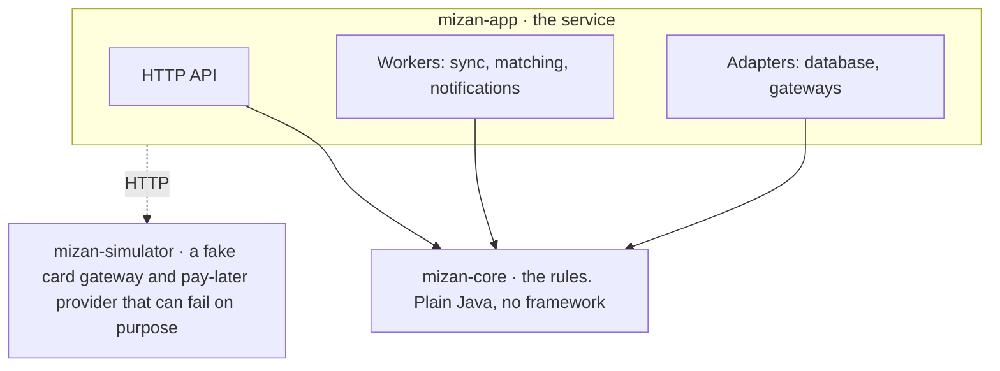
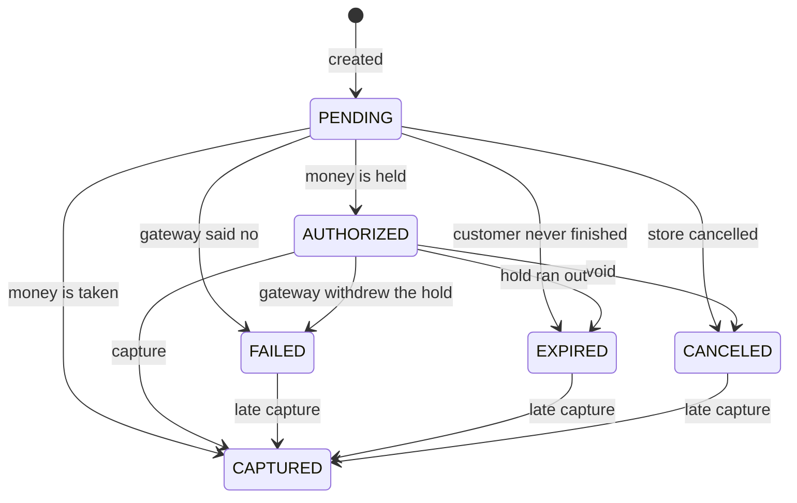
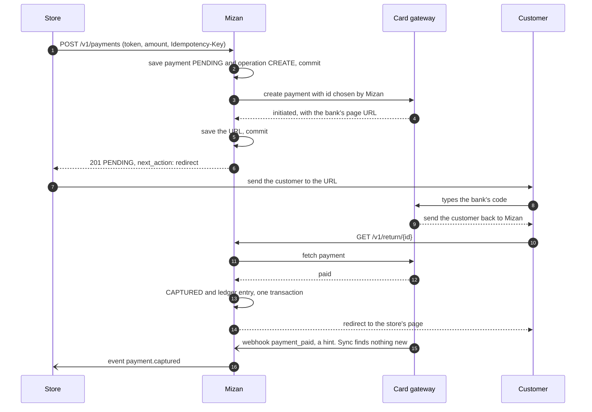
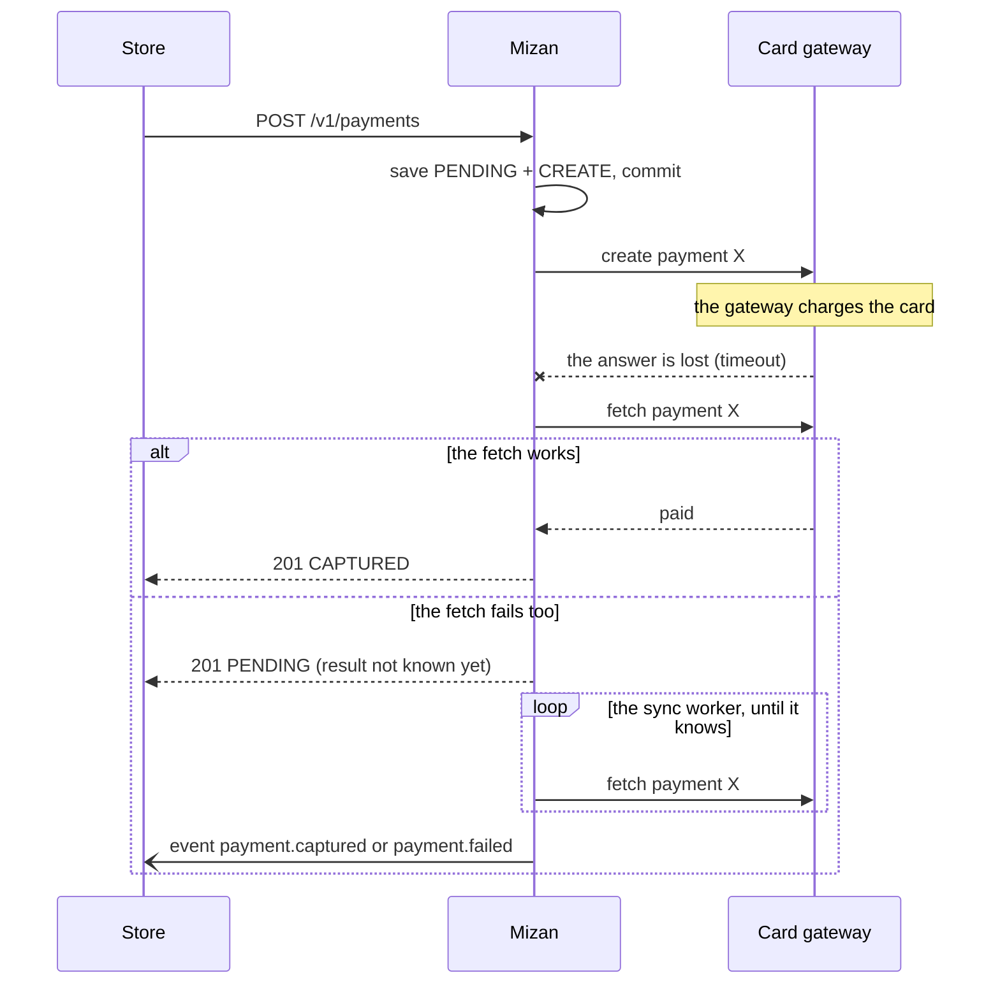
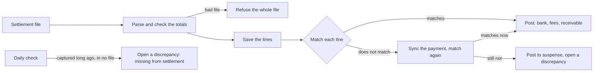

# Mizan — design

Mizan is the payments service of an online store. It takes payments, confirms them, gives money back, keeps the books, and checks that the money the gateway paid out is the money the store sold.

*Mizan* (ميزان) is Arabic for a scale: both sides must balance. It is a working name.

This page is the high-level design. Each part has a low-level design in [lld](lld/README.md). Decisions are in [adr](adr/README.md). Words are in the [glossary](GLOSSARY.md).

## 1. Context

A store in Saudi Arabia takes money in three common ways:

| Method | How the customer pays | Who moves the money |
|---|---|---|
| Card (mada, Visa, Mastercard) | Types the card on the gateway's page, often with a one-time code from the bank (3-D Secure) | The card gateway |
| Wallet (Apple Pay) | Confirms on the phone. No extra code | The card gateway |
| Pay later | Is sent to the provider's page and approves a plan | The pay-later provider |

The store never sees a card number. The gateway's page turns the card into a **token**, and Mizan works with the token.

## 2. Goals and non-goals

### Goals

| # | Goal |
|---|---|
| G1 | The store takes a payment with one API call, for all three methods. |
| G2 | **A customer is never charged twice, and no payment is lost,** when calls time out, answers get lost, and webhooks come twice, late, out of order, or never. An order is paid once: a second payment that takes money for the same order is returned. |
| G3 | The store can authorize now and capture later, cancel, and refund in full or in parts. |
| G4 | Every riyal is in a double-entry ledger. The books always balance. |
| G5 | Mizan reads the gateway's settlement file and says which money matches, which is missing, and which is different. Money it cannot explain is never hidden. |
| G6 | The store learns every change through a signed event. |
| G7 | G2 and G5 are proven, not claimed: a simulator breaks things on purpose and a run checks the results. |

### Non-goals (for now)

- Storing or handling card numbers. Cards are tokens from the gateway's page.
- More than one currency. Amounts carry a currency, and only `SAR` is accepted.
- More than one capture per payment. One capture, full or partial; the rest is released.
- Chargebacks and disputes. A dispute line in a settlement file is reported as money Mizan cannot explain.
- Saved cards, subscriptions, and splitting a payment between sellers.
- More than one business. Mizan serves one store; its callers are the store's own systems.
- Returning the gateway's fee on a refund.
- Paying one order with two payments on purpose (split payment).
- Checking the payout against the bank statement. Mizan trusts the payout total in the settlement file.

## 3. Users

| User | How it talks to Mizan | What it does |
|---|---|---|
| Store backend | API key with the `payments` scope | Creates payments, captures, cancels, refunds, reads |
| Finance team | API key with the `backoffice` scope | Uploads settlement files, reads the ledger and reports, closes discrepancies |
| Gateway | Webhooks, checked with the gateway's secret | Says that something changed |
| Customer | Only through redirects: to the gateway's page and back | Pays |

## 4. Numbers that shape the design

| Number | Value | Why it matters |
|---|---|---|
| Payments | 1 million a month, 50 a second at the peak | One PostgreSQL database is enough. No sharding, no queue product |
| Gateway call | Usually 1 to 3 seconds; cut off after 10 | No database transaction may stay open that long (rule R5) |
| Webhook loss | Assume some never arrive | A webhook cannot be the only way to learn a result (rule R2) |
| Settlement file | Up to 200,000 lines | Read line by line, written in batches of 1,000, matched in batches. A file of 200,000 lines is taken in one call (tested) |
| Money | Whole halalas in a 64-bit integer | No rounding inside Mizan. 1 SAR = 100 halalas |

### Non-functional requirements

| Area | Requirement |
|---|---|
| Correctness | The rules in section 5 hold under every failure the simulator can make |
| Speed | Creating a payment costs one gateway call and two short transactions. No lock is held during a gateway call |
| Recovery | After a crash at any line, a restart finishes or safely repeats the work. Nothing needs a person |
| Audit | Ledger entries are never changed or deleted (the database refuses it). A settlement line keeps the gateway's figures as they came; only its status changes. Gateway events are kept 90 days |
| Simplicity | One service, one database, plain SQL. A new engineer can follow one payment through the code in an hour |

## 5. The seven rules

Everything else follows from these.

| # | Rule | Why |
|---|---|---|
| R1 | **The gateway knows the truth about money. Mizan keeps a copy.** One function, *sync*, reads the gateway's record of a payment and updates the copy. Every path uses it | One place to get right. A webhook, a retry, a timer and reconciliation cannot disagree, because they all end in the same function |
| R2 | **A webhook is a hint, not a fact.** When a webhook comes, Mizan asks the gateway and syncs | Webhooks come twice, late, out of order, or never, and a shared secret can leak. The gateway's own answer has none of these problems |
| R3 | **Mizan chooses the gateway's payment id before the first call,** and saves it | If the answer is lost, Mizan can still ask "what happened to payment X?" |
| R4 | **One operation at a time per payment.** A capture, a cancel or a refund must finish before the next one starts | The gateway reports totals ("refunded so far"). With one operation at a time, a change in a total has one clear cause |
| R5 | **No gateway call inside a database transaction.** Write the intent and commit; call; then write the result | A slow gateway must not hold locks. A crash between the steps leaves an intent that a worker finishes |
| R6 | **Every money fact is posted to the ledger once, in the same transaction that records it.** | The payment and the books cannot drift apart |
| R7 | **Money that cannot be explained goes to a suspense account.** It stays there, visible, until someone explains it | Nothing is dropped and nothing is guessed |

## 6. The parts

Mizan is one service with one database. The code is in three modules.

| Module | Holds | Depends on |
|---|---|---|
| `mizan-core` | Money, the payment and its states, *sync*, ledger rules, fees, settlement matching | Only the JDK |
| `mizan-app` | The API, the use cases, the database, the gateway clients, the workers | `mizan-core`, Spring Boot |
| `mizan-simulator` | The fake gateways, their faults, their settlement files | `mizan-core` (money only) |

Inside `mizan-app`, the layers are adapters → application → domain (the domain is `mizan-core`). Architecture tests enforce them.

The proof run is a test of `mizan-app` (`ProofRunIT`), not a module of its own: it needs exactly the world the other integration tests build (a database in a container, the simulator, Mizan, one clock), and a fourth module would have copied it.

## 7. A payment's life

### 7.1 States

| State | Meaning | Money |
|---|---|---|
| `PENDING` | Created. The result is not known yet, or the customer must act | None |
| `AUTHORIZED` | The bank holds the amount for the store | Held, not taken |
| `CAPTURED` | The amount is taken. Refunds are counted in `refundedAmount`; the state stays `CAPTURED` | Taken |
| `FAILED` | The gateway refused | None |
| `CANCELED` | The store cancelled, or voided the hold | None |
| `EXPIRED` | The customer did not finish in time, or the hold ran out | None |

`FAILED`, `CANCELED` and `EXPIRED` are final for the store. They are not final for the truth: if the gateway later shows that the money was taken, rule R1 wins. This is a **late capture** (section 7.5).

### 7.2 Card payment with a bank code

Steps 9 to 12 may never happen: the customer closes the tab. Then the webhook (step 15) or the timer does the same sync. All three paths are safe to run together, in any order, any number of times.

### 7.3 A lost answer

If the fetch still says "no such payment" one quiet minute after the call, the request never arrived, and the payment is `FAILED`. Mizan does not send the request again: it no longer has the card's token, by design. If the gateway takes the money after all, that is a late capture (section 7.5).

The store's retry is covered too: the same `Idempotency-Key` returns the same payment and never creates a second one.

### 7.4 Capture, cancel and refund

All three follow one pattern (rules R4 and R5):

1. Fetch the gateway's record, so the rules are checked on fresh totals.
2. In one transaction: lock the payment, sync, check the rule, save an **operation** in flight. A second operation on the same payment is refused with `409`.
3. Call the gateway.
4. Sync. If the totals moved, the operation succeeded.
5. If the result is not known, the operation stays in flight. The worker waits one quiet minute and fetches. If nothing changed, it sends the call again once, **but only when a repeat cannot move money twice**. A refund at the card gateway is never repeated: it is reported as failed, and the store decides.

A refund is checked under the lock: `refund ≤ captured − refunded`.

### 7.5 Late capture

A payment is `EXPIRED`, `FAILED` or `CANCELED` in Mizan, and later the gateway shows the money was taken. Example: the customer finished the bank's page after an hour.

| Step | What Mizan does |
|---|---|
| 1 | Records the truth: the payment becomes `CAPTURED`, marked `late`, with its ledger entry |
| 2 | Tells the store: `payment.captured` with `late: true` |
| 3 | Gives the money back: starts a full refund by itself (the store did not deliver the order). This policy can be switched to "keep", except when another payment of the same order already has the money |

The same idea covers a late hold: a hold that appears on a dead payment is voided.

### 7.6 One order, one payment that counts

A customer can pay the same order in two tabs. The store's `reference` is the order, and Mizan lets only one payment per order keep the money:

- When a payment takes or holds money, the order's other waiting payments are canceled.
- If a canceled one takes money later, it is a late capture, and the money is returned.
- A new payment is refused while an earlier one of the same order has an unknown result, or when the order is already paid.

Details are in [payments](lld/payments.md#one-order-one-payment-that-counts).

## 8. The ledger

Every money fact becomes one journal entry with equal debits and credits.

| Account | Kind | Holds |
|---|---|---|
| `gateway_receivable` | Asset | Money the gateway owes the store: captured, not yet paid out |
| `bank` | Asset | Money the gateway has paid out |
| `sales` | Income | What customers paid, minus refunds |
| `gateway_fees` | Expense | What the gateway kept |
| `suspense` | Liability | Money received that Mizan cannot explain yet |
| `adjustments` | Income or expense | Differences that finance accepted, with a note |

| Fact | Debit | Credit |
|---|---|---|
| Capture of 100.00 | `gateway_receivable` 100.00 | `sales` 100.00 |
| Refund of 30.00 | `sales` 30.00 | `gateway_receivable` 30.00 |
| Settlement line: 100.00 paid out, fee 2.50 | `bank` 97.50, `gateway_fees` 2.50 | `gateway_receivable` 100.00 |
| Settlement line for a refund of 30.00 | `gateway_receivable` 30.00 | `bank` 30.00 |
| Settlement line Mizan cannot match: 49.00 reached the bank | `bank` 49.00 | `suspense` 49.00 |

What must always be true:

| Invariant | Meaning |
|---|---|
| Debits = credits, in every entry and in total | The books balance |
| `gateway_receivable` of one payment ends at zero | The gateway paid out exactly what was captured minus what was refunded |
| `suspense` = the sum of open money discrepancies | Unexplained money is all visible |
| Entries are never changed or deleted | A mistake is fixed by a new entry |

The database itself refuses an unbalanced entry and any change to an old one.

## 9. Settlement and reconciliation

The gateway pays the store some days after a capture, in one transfer for many payments, minus its fees. It sends a **settlement file**: one line per capture or refund.

| Discrepancy | Meaning | Money goes to |
|---|---|---|
| `UNKNOWN_PAYMENT` | The line names a payment Mizan does not have | Suspense |
| `NOT_CAPTURED_HERE` | The gateway paid out a payment Mizan does not hold as captured, even after a sync | Suspense |
| `AMOUNT_MISMATCH` | The line's amount is more than what is still unsettled for this payment | Suspense |
| `UNKNOWN_REFUND` | A refund line with no refund in Mizan, even after a sync | Suspense |
| `DUPLICATE_SETTLEMENT` | The same gateway transaction was settled before | Suspense |
| `UNKNOWN_LINE_TYPE` | A line that is not a capture or a refund, such as a chargeback | Suspense |
| `FEE_MISMATCH` | The fee is not what the fee table says | Posted normally. The difference is reported |
| `MISSING_FROM_SETTLEMENT` | Captured or refunded more than N days ago and in no file | Nothing moves. The receivable stays open |

A sync before giving up matters: it is how a payment that Mizan lost (a late capture, a refund made in the gateway's dashboard) is found and recorded. Reconciliation is the last safety net of rule R1.

A discrepancy closes in one of three ways: a later sync makes the line match (`REMATCHED`), a later file settles the payment (`SETTLED_LATER`), or finance accepts the difference with a note (`ACCEPTED`), which moves the money from `suspense` to `adjustments`.

## 10. Telling the store

Each change writes an event in the same transaction as the change (an **outbox**). A worker sends it to the store's URL.

| Event | When |
|---|---|
| `payment.authorized`, `payment.captured`, `payment.failed`, `payment.canceled`, `payment.expired` | The payment changed state |
| `refund.succeeded`, `refund.failed` | A refund finished |
| `capture.failed`, `cancel.failed` | A capture or a cancel did not work |
| `discrepancy.opened` | Reconciliation found a difference |

- Each event is signed: `HMAC-SHA256(secret, timestamp + "." + body)`.
- Delivery is **at least once**, with growing waits between tries. The event id lets the store ignore a repeat.
- Order is not promised. Each event carries the payment's `version`, so the store can ignore an older one.

## 11. API conventions

| Topic | Rule |
|---|---|
| Style | JSON over HTTPS, paths under `/v1` |
| Money | `amount` is an integer in halalas, with `currency: "SAR"` |
| Idempotency | Every `POST` that moves money needs an `Idempotency-Key`. The same key and body return the same payment or operation, as it is now; the same key with another body is refused with `422` |
| Errors | `application/problem+json` with a stable `code` |
| Unknown results | A call whose result is not known yet answers with the payment in `PENDING` or the operation in `PENDING`, never with an error that invites a blind retry |
| Lists | Cursor pages, newest first |

The full list is in the [API design](lld/api.md).

## 12. Security

| Risk | Answer |
|---|---|
| Card data | Never enters Mizan. Tokens are used once, never stored, never logged |
| Callers | API keys with scopes, stored as hashes and looked up by the hash, so no comparison can leak timing |
| Forged webhooks | The gateway's secret is checked. Even a forged webhook can only make Mizan ask the gateway (R2); it cannot change money |
| Replayed webhooks | The same event id is stored once. A replay only causes another harmless sync |
| Changed amounts | A gateway record whose amount or currency differs from the payment is never accepted as paid |
| Open redirect | The store's return URL must start with a configured address |
| The customer's return page | Needs no key, so it does little: it asks for at most one sync of a payment every two seconds, and reveals nothing |
| Secrets | Gateway keys and signing secrets come from the environment. They are not in the database or the logs |
| Abuse | A request limit per API key, a body size limit, and strict input checks |

## 13. Operations

| Topic | Design |
|---|---|
| Workers | Run inside the service. Each takes rows with `FOR UPDATE SKIP LOCKED`, so two instances never take the same row |
| Health | Liveness and readiness endpoints |
| Metrics | Payments by state, age of the oldest pending payment, operations in flight, events waiting, open discrepancies, suspense balance |
| Logs | Each line of a request carries its request id. No headers, bodies, tokens or secrets. JSON lines can be switched on with Spring Boot's `LOGGING_STRUCTURED_FORMAT_CONSOLE=ecs` |
| Configuration | One file with defaults; the environment overrides |

## 14. Testing and proof

| Layer | What it proves | Runs |
|---|---|---|
| Unit and property tests of `mizan-core` | *Sync*, the ledger rules, fees and matching, for every state and for thousands of generated cases | Always |
| Integration tests of the service with PostgreSQL and the simulator | Each flow, each failure, each race | Always |
| **The proof run** | Thousands of payments with faults from a seeded plan. At the end: Mizan's states and ledger equal the simulator's own record; nobody was charged twice; every planted settlement error was reported and nothing else was | Always (short), on demand (long) |
| A real gateway's test mode | The adapter, the statuses and the webhooks against a real gateway | On demand: needs test keys |

The simulator is not the gateway. It behaves as the gateways' public documents say, and where the documents are silent it is strict. Every difference found against a real gateway becomes a simulator fault and a test.

Every component is also checked with deliberate bugs: a bug is planted, the tests must fail, the bug is removed.

## 15. Assumptions to confirm

| # | Assumption | Confirmed by |
|---|---|---|
| A1 | The card gateway accepts a payment id chosen by the caller and creates that payment at most once | The gateway's documents and its test mode |
| A2 | Fetching a payment returns its current totals (captured, refunded) at once after a change | Test mode |
| A3 | A refund call has no idempotency key at the card gateway, so "fetch, then repeat once" is the safe way | Documents (stated), test mode |
| A4 | A hold that the bank released stays `authorized` at the gateway, so Mizan must expire holds itself | Documents (stated) |
| A5 | The settlement file has one line per capture and per refund, with gross, fee and net | A real settlement file |
| A6 | An unfinished pay-later session cannot be paid if its page address was never given to the customer | The provider's documents |

A milestone that depends on one of these says so in the status page until the check has run.

## 16. Delivery plan

| # | Milestone | Result |
|---|---|---|
| M0 | Foundation | The build, the modules, the layer tests, CI |
| M1 | The rules | Money, states, *sync*, ledger rules, fees, matching. Property tests |
| M2 | The simulator | Both fake gateways, their faults, webhooks and settlement files |
| M3 | Payments | The API, idempotency, operations, gateway clients, the ledger in the database |
| M4 | Webhooks and workers | The inbox, the sync worker, expiry, late capture |
| M5 | Reconciliation | Settlement files, matching, discrepancies, suspense, reports |
| M6 | Events and hardening | The outbox, security, limits, metrics, the API description, Docker |
| M7 | Proof | The proof run, the real gateway adapter, the demo, the interview page, the final review |

Details are in the [plan](plan/PLAN.md).

## 17. Risks

| Risk | Answer |
|---|---|
| The simulator behaves differently from a real gateway | Keep the gateway behind one small interface; run the real test mode when keys are there; list the assumptions (section 15) |
| A refund is sent twice | Mizan never repeats a refund by itself unless the gateway takes a refund key. A refund the gateway did after all is found by the next sync and counted before any new refund |
| The gateway's record is wrong | Mizan follows it (R1) but refuses records that move backwards or change the amount, and reports them |
| The ledger grows without end | Entries are small. Partitioning by month is possible later and changes no rule |
