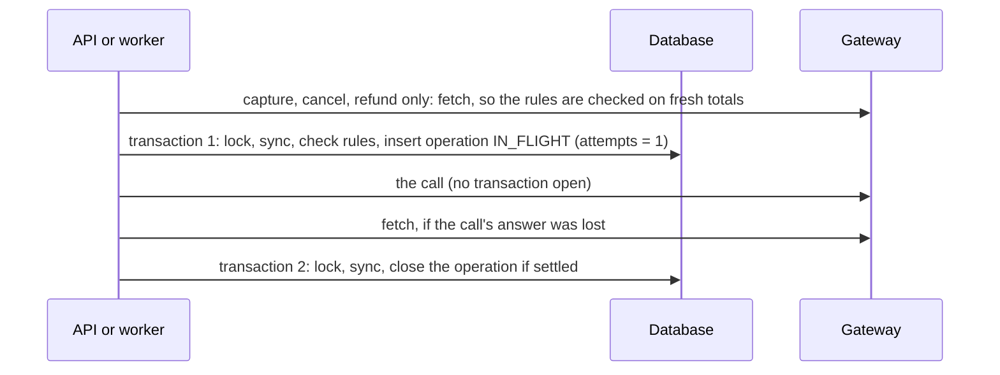
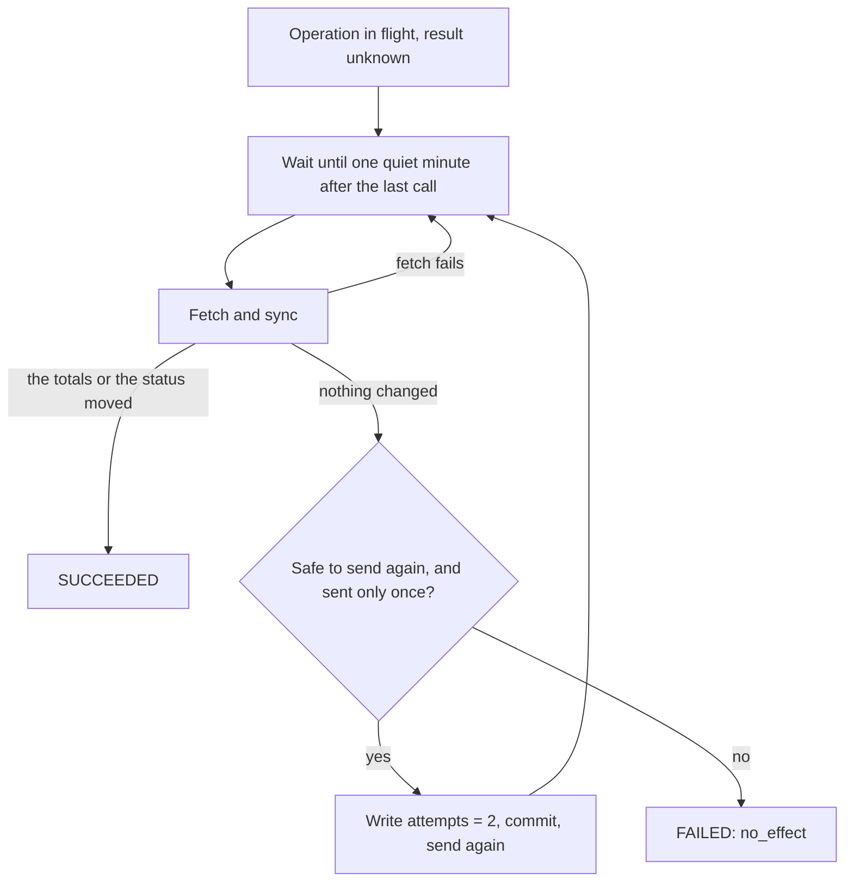

# Payments and operations

A **payment** is one attempt to take one amount for one order. An **operation** is one thing Mizan asks the gateway to do to a payment.

## The payment

| Field | Meaning |
|---|---|
| `id` | UUID, chosen by Mizan |
| `reference` | The store's order number. An order may have several attempts, but only one that counts (see below) |
| `amount`, `currency` | Halalas, `SAR` |
| `method` | `CARD`, `APPLE_PAY`, `PAY_LATER` |
| `gateway` | `CARD_GATEWAY` or `PAY_LATER`. Follows from the method |
| `captureMode` | `AUTO` (take the money at once) or `MANUAL` (hold, capture later) |
| `status` | See [the states](../DESIGN.md#71-states) |
| `capturedAmount`, `refundedAmount` | Totals so far |
| `settledCaptured`, `settledRefunded` | How much of those totals the gateway has paid out ([reconciliation](reconciliation.md)) |
| `gatewayPaymentId` | The payment's id at the gateway. For cards Mizan chooses it (rule R3) |
| `gatewayStatus` | The gateway's last status that Mizan saw. Empty before the first record |
| `actionUrl` | Where the customer must go next |
| `returnUrl` | Where the customer is sent after paying. Must start with a configured address |
| `failureCode`, `failureMessage` | Why it failed |
| `scheme`, `last4` | Card display data from the gateway |
| `late` | The money was taken after the store was told it would not be |
| `followUp` | An operation Mizan must start by itself: none, `AUTO_CAPTURE`, `AUTO_VOID`, `AUTO_REFUND` |
| `expiresAt` | When a `PENDING` payment stops waiting for the customer |
| `holdEndsAt` | When an `AUTHORIZED` payment can no longer be captured |
| `capturedAt`, `lastRefundAt` | For the daily settlement check |
| `nextSyncAt` | When the sync worker looks at it next. Empty: never |
| `lastSyncedAt` | When the gateway's record was last applied |
| `version` | Grows with every change. Sent in events |

## The operation

| Field | Meaning |
|---|---|
| `type` | `CREATE`, `CAPTURE`, `CANCEL`, `REFUND` |
| `status` | `IN_FLIGHT`, `SUCCEEDED`, `FAILED` |
| `origin` | `API` (the store asked), `SYSTEM` (a follow-up), `GATEWAY` (a refund made outside Mizan, recorded after the fact) |
| `amount` | For capture and refund |
| `attempts`, `lastAttemptAt` | Calls sent to the gateway. **Written and committed before each call**, so a crash never hides a call that may have been sent |
| `resultCode` | Why it failed |
| `reason` | Free text from the store, for a refund |

**One operation in flight per payment** (rule R4). The database enforces it with a unique index.

A **refund** in the API is an operation of type `REFUND`. There is no separate refund table.

## The pattern of every command

If the process dies after transaction 1, the operation is in flight with no result. The sync worker finds it and continues from "fetch".

| Detail | Why |
|---|---|
| If the first fetch fails, capture, void and refund go on with Mizan's own totals | The gateway itself refuses a refund above what is left, so nothing can go wrong; and a gateway that cannot be asked now may still take the call |
| After a clear "no" from the gateway, Mizan still fetches before it writes the "no" down | The money may have moved all the same, for example by an earlier call whose answer was lost. The record is the truth (rule R1) |
| Transactions are opened through one small interface, `Transactions` | It is plain in the code where each one begins and ends, and that the call stands between two of them (rule R5) |

**Locking.** Every transaction that changes a payment first locks the order (an advisory lock on the `reference`), then the payment row. One helper does both, in this order, everywhere.

## Create

| Step | Detail |
|---|---|
| Checks | Amount from 100 halalas to the configured limit; currency `SAR`; method known; the source fits the method; `returnUrl` allowed |
| Transaction 1 | Lock the order. Look up the `Idempotency-Key`. Check the order's other payments (below). Insert the payment `PENDING` with `expiresAt`, and the `CREATE` operation |
| Call | Card and Apple Pay: create with Mizan's id, `manual` if `captureMode = MANUAL`. Pay later: create a checkout session |
| Transaction 2 | Sync with the answer |

| The gateway's answer | Payment | Store gets |
|---|---|---|
| Paid | `CAPTURED` | `201`, `CAPTURED` |
| Authorized | `AUTHORIZED` | `201`, `AUTHORIZED` |
| Initiated, with a URL | `PENDING` | `201`, `PENDING`, `next_action: redirect`, `pending_reason: customer_action` |
| Declined (card refused, bad token) | `FAILED` with the code | `201`, `FAILED` |
| Lost; the fetch finds the payment | As the fetch says | `201` with that state |
| Lost; the fetch says not found, or fails | `PENDING`, operation in flight | `201`, `PENDING`, `pending_reason: gateway_unknown` |
| Lost, pay later | `FAILED`: `gateway_unreachable` | `201`, `FAILED` |

- A declined payment is a `201`, not an error: the payment exists and the store can read why it failed.
- Pay later needs no lookup: the customer was never given the provider's page, so the session cannot be paid (assumption A6).
- **Mizan never sends a create again.** It cannot: the token is gone, by design ([ADR-0011](../adr/0011-no-card-data.md)). And it need not: see the next section.

## One order, one payment that counts

The store's `reference` is the order. A customer can open two tabs, or try a second card while the first attempt is still waiting. Without a rule, both could take money.

| Rule | When | What happens |
|---|---|---|
| No second payment while the first is unknown | A payment of the same reference is `PENDING` with `pending_reason: gateway_unknown` | Create is refused: `409 previous_payment_unresolved`. The answer comes within about a minute |
| No second payment for a paid order | A payment of the same reference is `AUTHORIZED`, or `CAPTURED` and not fully refunded | Create is refused: `409 reference_already_paid` |
| The first to take money wins | A payment becomes `AUTHORIZED` or `CAPTURED` | The order's other `PENDING` payments become `CANCELED` (the `CancelSiblings` effect of [sync](sync.md#the-decision)) |
| The loser is returned | A canceled payment takes money later | It is a late capture: recorded, then refunded. This holds even when the late-capture policy is "keep", if another payment of the order has the money |

A second attempt while the first is waiting for the customer (`pending_reason: customer_action`) is allowed: people do change cards.

The order's advisory lock makes these checks safe when two requests, or two syncs, for the same order run at the same moment.

## Capture

| Rule | Refusal |
|---|---|
| The payment is `AUTHORIZED` | `409 not_capturable` |
| `now < holdEndsAt` | `409 hold_expired` |
| `0 < amount ≤ payment amount`. Default: the full amount | `422 invalid_amount` |
| Pay later: the full amount only | `422 partial_capture_not_supported` |
| No operation in flight | `409 operation_in_progress` |

One capture per payment. A partial capture releases the rest.

## Cancel

| Payment | What happens |
|---|---|
| `AUTHORIZED` | A `CANCEL` operation: void at the gateway. Then `CANCELED` |
| `PENDING`, waiting for the customer | `CANCELED` at once, after the fresh sync showed no money. No call is needed, and a `CANCEL` operation is recorded as done. If the gateway could not be asked: `503 gateway_unavailable`, and nothing changes. If the customer pays later, that is a late capture |
| `PENDING`, result unknown | `409 operation_in_progress` |
| `CAPTURED` | `409 already_captured`: use a refund |
| `FAILED`, `CANCELED`, `EXPIRED` | `409 not_cancelable` |

## Refund

| Rule | Refusal |
|---|---|
| The payment is `CAPTURED` | `409 not_refundable` |
| `0 < amount ≤ capturedAmount − refundedAmount`. Default: all that is left | `422 refund_too_large` |
| No operation in flight | `409 operation_in_progress` |

The check runs after a fresh sync and under the lock, so two refunds sent together cannot both pass, and a refund made in the gateway's dashboard is counted.

| The gateway's answer | Operation | Store gets |
|---|---|---|
| Done | `SUCCEEDED` | `201`, `SUCCEEDED` |
| Refused | `FAILED` with the code | `201`, `FAILED` |
| Lost | `IN_FLIGHT` | `202`, `PENDING` |

Capture and cancel answer in the same way.

## When the result is not known

The call timed out, or the gateway answered with a server error, and a fetch did not settle it. The operation stays in flight and the sync worker owns it.

| Operation | "Moved" means | Safe to send again? | If it ends as `no_effect` |
|---|---|---|---|
| `CREATE` | The gateway has the payment | **No.** The token is gone | The payment becomes `FAILED`: `gateway_unreachable` |
| `CAPTURE` | `captured` grew | Yes. A second capture of a captured payment is refused by the gateway | The payment stays `AUTHORIZED`. `capture.failed` |
| `CANCEL` | The gateway shows `VOIDED` | Yes. A second void changes nothing | The payment stays `AUTHORIZED`; the hold ends at `holdEndsAt`. `cancel.failed` |
| `REFUND` | `refunded` grew by at least the amount | **Only if the gateway takes a refund key** (pay later). The card gateway does not (assumption A3) | `refund.failed`. The store may ask again |

**Why a refund is never repeated without a key.** If the first call is still on its way, a fetch shows nothing, and a second call would refund twice. So Mizan reports the refund as failed and lets the store decide. If the first call lands after all, the next sync sees `refunded` grow and records it (rule R1), and a new refund request is checked against the fresh total.

**Why one quiet minute.** Gateway calls are cut off after 10 seconds. After a minute, a call that left Mizan has landed or died. Deciding earlier would call a slow success a failure.

A `CREATE` that ends as `no_effect` changes the payment only if it is still `PENDING`. A payment that was canceled meanwhile stays canceled.

**Why "failed" is still safe.** If the gateway did the work after all, the next sync sees the totals move and records the facts. An operation's status is a report; the totals are the truth. For a payment this is a late capture.

## Follow-ups

Operations Mizan starts by itself. They use the same pattern and the same rules.

| Follow-up | Started when | Does |
|---|---|---|
| `AUTO_CAPTURE` | A pay-later payment with `captureMode = AUTO` becomes `AUTHORIZED` | Captures the full amount |
| `AUTO_VOID` | A hold appears on a dead payment, or a hold's time ran out | Voids. Tried once |
| `AUTO_REFUND` | A late capture, and the policy is "refund" | Refunds all that is captured and not refunded. Tried once |

A follow-up is started in the same step of the sync worker as the look that found the reason for it. So the store sees, a moment apart, `payment.captured` and then `refund.succeeded` for a late capture.

A follow-up that fails is not repeated. The store gets the failure event, and the payment shows what is left. A follow-up whose reason is gone by the time it starts (the money went back in another way) is dropped and not counted as started.

## Races

| Race | What decides |
|---|---|
| Two requests with the same `Idempotency-Key` | The key is unique. The second waits for the first transaction, then gets the same payment |
| Two payments for one order at once | The order's lock, then the rules of "one order" |
| Capture and cancel together | One inserts its operation; the other gets `409 operation_in_progress` |
| A webhook during an operation | Both end in sync under the payment's lock. Sync is safe to repeat (property P1) |
| Two fetches finish in the wrong order | The older record is ignored ([sync](sync.md#old-snapshots-are-normal)) |
| Two workers pick the same payment | `FOR UPDATE SKIP LOCKED`: the second skips it |
| Refund while a refund is in flight | `409`. The store retries when the first is finished |
| The customer pays while the timer expires the payment | The timer syncs first. If it loses the race anyway, the payment is a late capture |

## Tests

| Test | Proves |
|---|---|
| Create tests, one per answer in the table | States, the store's answer, the saved operation |
| Idempotency tests | Same key: one payment; another body: `422`; two at once: one payment |
| One-order tests | Each row of the table; two tabs paying at once end with one payment kept and one returned |
| Capture, cancel, refund tests | Every rule and refusal; totals; ledger entries; the fresh sync before the check |
| Unknown-result tests (the simulator loses answers) | Charged and answer lost → found by fetch; a create and a card refund are never sent twice; a capture is sent again once |
| Race tests (threads) | Each row of the race table |
| Crash tests (stop after transaction 1) | The worker finishes the operation |
