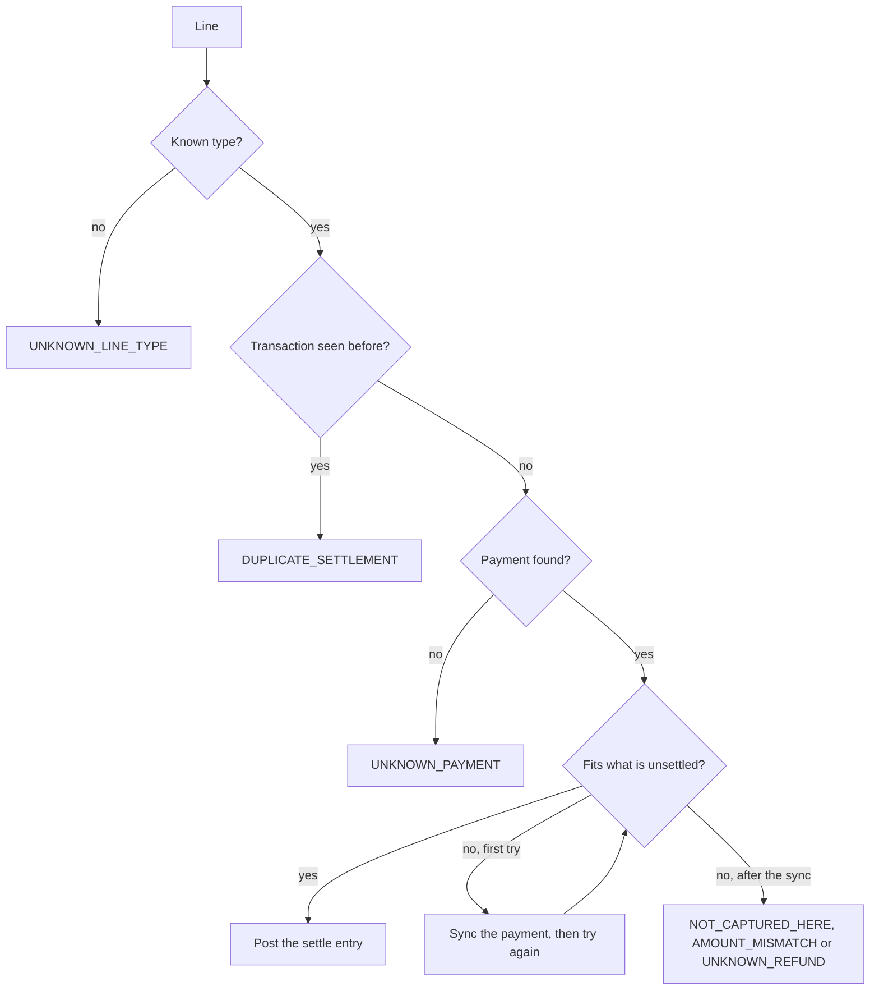

# Reconciliation

Reconciliation answers one question: **did the gateway pay the store what Mizan says it should?**

## The settlement file

The gateway pays out once a day and gives a file for that payout. Mizan reads one neutral format; each gateway has a small parser that turns its file into it.

```
H,payout_id,gateway,currency,payout_date,total_net,line_count
L,transaction_id,payment_id,type,gross,fee,net,occurred_at
L,...
```

| Field | Meaning |
|---|---|
| `payout_id` | The gateway's id of this payout. One file per payout |
| `total_net` | The amount sent to the bank |
| `transaction_id` | The gateway's id of this line. The same transaction is never paid twice |
| `payment_id` | The gateway's payment id |
| `type` | `capture`, `refund`, or anything else |
| `gross` | The amount of the capture; negative for a refund |
| `fee` | What the gateway kept; may be negative when it returns a fee |
| `net` | `gross − fee` |

Amounts are in halalas.

## Step 1 — accept or refuse the file

The file is read one line at a time. It is refused as a whole, and nothing is saved, if:

| Check | Error |
|---|---|
| The header or a line cannot be read; a number is not a whole number; a field is missing | `malformed_file` |
| The file is over 50 MB, or has more than 500,000 lines | `file_too_large` |
| The gateway is not known, or the currency is not `SAR` | `wrong_gateway`, `wrong_currency` |
| `line_count` is not the number of lines | `line_count_mismatch` |
| For a line, `net ≠ gross − fee` | `line_does_not_add_up` |
| A capture line with `gross ≤ 0`, a refund line with `gross ≥ 0`, or a fee larger than the amount | `malformed_file` |
| The sum of `net` is not `total_net` | `payout_total_mismatch` |
| The same `payout_id` was imported with other content | `409 payout_exists` |

The same file again (same `payout_id`, same hash) is answered with the first import. Nothing happens twice.

A refused file is the gateway's mistake or a broken upload. Mizan posts nothing from a file it cannot trust as a whole.

## Step 2 — match each line

The matching worker takes lines in file order.



| Line | Fits when | If it fits |
|---|---|---|
| Capture, gross `g` | `g ≤ capturedAmount − settledCaptured` | `settledCaptured += g`, entry `SETTLE_CAPTURE` |
| Refund, amount `r` | `r ≤ refundedAmount − settledRefunded` | `settledRefunded += r`, entry `SETTLE_REFUND` |

A line that fits but leaves part of the payment unsettled is fine: the rest is expected in a later file, and the daily check watches it.

The sync before giving up is rule R1 at work. It finds a capture Mizan lost and a refund made in the gateway's dashboard. The sync is a gateway call, so it runs outside the transaction (rule R5): the line is marked `NEEDS_SYNC`, the payment is synced, and the line is tried once more.

| The line does not fit, after the sync | Discrepancy |
|---|---|
| Capture line, the payment has nothing captured | `NOT_CAPTURED_HERE` |
| Capture line, the payment has less unsettled than the line | `AMOUNT_MISMATCH` |
| Refund line, the payment has less unsettled refund than the line | `UNKNOWN_REFUND` |

A line with a discrepancy is still money that reached the bank. Its net amount is posted to `suspense` (rule R7) and a discrepancy is opened with that amount.

If the gateway cannot be reached for the sync, the line waits as `NEEDS_SYNC` and is tried again later. The file's progress shows it.

### Fees

For a matched capture line, the fee is compared with the fee table.

```
base = round_half_up(gross × percent) + fixed
fee  = base + round_half_up(base × VAT)
```

| Setting | Meaning |
|---|---|
| `percent` (in hundredths of a percent), `fixed` (halalas) | Per method and card scheme, from the store's contract with the gateway |
| `VAT` | 15% on the fee |

If the line's fee differs: the line is posted with the **real** fee, and a `FEE_MISMATCH` discrepancy records expected and actual. No money goes to suspense: the money is explained, only its price is not.

## Step 3 — the daily check

Once a day, and after each file:

| Finds | Opens |
|---|---|
| A payment with `capturedAmount − settledCaptured > 0`, captured more than N days ago (default 3) | `MISSING_FROM_SETTLEMENT`, with the amount |
| The same for refunds | `MISSING_FROM_SETTLEMENT` |

One open discrepancy of this type per payment. It closes by itself (`SETTLED_LATER`) when a later file settles the rest.

## Discrepancies

| Field | Meaning |
|---|---|
| `type` | See the tables above, plus the sync anomalies |
| `paymentId`, `lineId` | What it is about |
| `expected`, `actual` | In halalas, when they apply |
| `suspenseAmount` | The net amount held in suspense for it. Zero for fee mismatches, missing settlements and anomalies |
| `status` | `OPEN` or `RESOLVED` |
| `resolution` | `REMATCHED`, `SETTLED_LATER`, `ACCEPTED` |
| `note` | Why finance accepted it |

| Action | Who | Does |
|---|---|---|
| `POST /v1/discrepancies/{id}/retry` | Finance | Syncs the payment and matches the line again. If it fits now: entry `REMATCH`, resolution `REMATCHED` |
| `POST /v1/discrepancies/{id}/accept` with a note | Finance | Entry `ACCEPT`: the money leaves `suspense` for `adjustments`. Resolution `ACCEPTED` |

Two more types come from outside reconciliation and are kept in the same list, with no money: `AMOUNT_CONFLICT` (from [sync](sync.md#anomalies)) and `UNKNOWN_PAYMENT_EVENT` (from a [webhook](workers.md#a-webhook-comes-in)). One open discrepancy of a type per payment.

## Settlement faults

The simulator can break its own settlement file. The proof run plants these and checks that each one is reported, and nothing else.

| Fault | The file | Mizan must |
|---|---|---|
| `missing_line` | Leaves a capture out | Open `MISSING_FROM_SETTLEMENT` after N days |
| `extra_line` | Adds a line for a payment that does not exist | Open `UNKNOWN_PAYMENT`, money in suspense |
| `wrong_amount` | A capture line with more than was captured | Open `AMOUNT_MISMATCH`, money in suspense |
| `short_amount` | A capture line with less than was captured | Match the line; open `MISSING_FROM_SETTLEMENT` for the rest after N days |
| `wrong_fee` | A fee that is not the table's | Open `FEE_MISMATCH`, post the real fee |
| `duplicate_line` | The same transaction in two files | Open `DUPLICATE_SETTLEMENT`, money in suspense |
| `lost_capture` | A line for a capture that Mizan holds as failed (the answer and the webhook were lost, and the sync worker was off) | Sync, record the late capture, match the line. No discrepancy |
| `dashboard_refund` | A refund line for a refund made outside Mizan | Sync, record the external refund, match the line. No discrepancy |
| `chargeback_line` | A line of type `chargeback` | Open `UNKNOWN_LINE_TYPE`, money in suspense |
| `bad_total` | `total_net` is wrong | Refuse the file |
| `broken_file` | A cut-off file | Refuse the file |
| `same_file_twice` | The same file again | Answer as the first time; post nothing |

## Tests

| Test | Proves |
|---|---|
| Parser tests | Each refusal of step 1; a large file is read as a stream |
| Matching tests (pure, in `mizan-core`) | Each branch of the flow, each discrepancy type |
| Property test: any payments and any file made from them, lines in any order | After matching: `bank` = the sum of `net`; I1 to I4 of the [ledger](ledger.md#what-must-always-be-true) hold |
| Import tests with the database | The same file twice; a crash in the middle of matching continues; two workers |
| Fault tests | Each row of the settlement faults table |
| Discrepancy tests | Retry, accept, closing by itself; who may do what |
