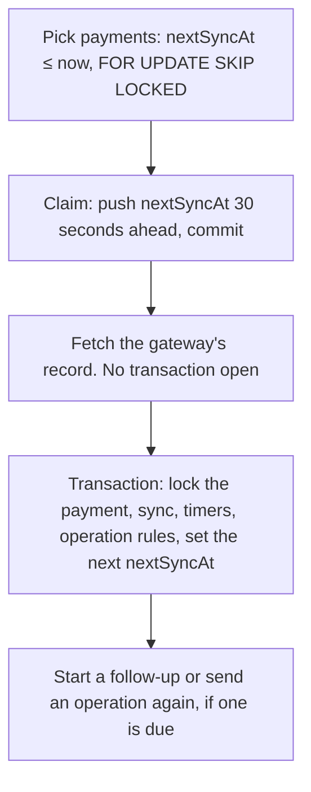

# Webhooks in and the workers

Three workers run inside the service: the **sync worker**, the **matching worker** ([reconciliation](reconciliation.md)) and the **event sender** ([API](api.md#events-sent-to-the-store)). This page covers how a webhook comes in and how the sync worker runs.

## A webhook comes in

`POST /v1/webhooks/{gateway}`

| Step | Detail |
|---|---|
| 1. Size | A body over 64 KB is refused with `413` |
| 2. Check | The gateway's secret or signature. Wrong: `401`, nothing is saved |
| 3. Read | Only the event id, the event type and the gateway's payment id. Missing: `400` |
| 4. Save | One transaction: insert the event (the event id is unique per gateway); set the payment's `nextSyncAt = now` |
| 5. Answer | `200`, also for a repeated event and for an unknown payment |

The handler never calls the gateway and never changes a payment's state. It is fast, so the gateway rarely has to retry.

| Case | What happens |
|---|---|
| The same event twice | The insert finds the id. Nothing else happens. `200` |
| Events out of order | No effect: the status in the event is not used |
| An event for a payment Mizan does not have | Saved as unmatched, and one `UNKNOWN_PAYMENT_EVENT` discrepancy is opened per gateway payment id. Someone took a payment at the gateway outside Mizan |
| An event before the create call's answer | The payment row was committed before the call, so it is found |
| A forged event with the right secret | Mizan fetches the real record from the gateway. Nothing false is saved |
| A flood of events | The request limit applies. Extra syncs of the same payment are merged: `nextSyncAt` is one value |

## The customer comes back

`GET /v1/return/{paymentId}`

The gateway sends the customer here after the bank's page. Mizan ignores every query parameter the gateway added: they pass through the customer's browser and can be changed.

1. Try one sync now, for at most 5 seconds. If the payment was synced in the last two seconds, skip this step.
2. Redirect the customer to the payment's `returnUrl` with `payment_id` added. The store then reads the payment through the API.

An unknown id gives `404`. The endpoint needs no API key and reveals nothing: it only redirects to a URL the store gave. The two-second rule keeps a stranger from using it to flood the gateway with fetches.

## The sync worker

Every second it takes a batch of payments whose `nextSyncAt` has passed.

The claim in the second step is a lease. If the worker dies after it, the payment comes back after 30 seconds. Two instances never fetch the same payment at the same time, and if they did, sync is safe to repeat.

### When a payment is looked at next

| Payment | `nextSyncAt` |
|---|---|
| `PENDING`, waiting for the customer | 15 s, 30 s, 1 min, 2 min, then every 5 min, until `expiresAt`. Then once more, and `expirePending` |
| Any payment with an operation in flight | One quiet minute after the operation's last call |
| `AUTHORIZED` | At `holdEndsAt` |
| A follow-up is waiting | Now |
| `CAPTURED`, `FAILED`, `CANCELED`, `EXPIRED`, nothing waiting | Empty. A webhook or reconciliation sets it when there is news |
| A fetch failed | 30 s, then doubling up to 10 min |

### Times

| Setting | Default | Meaning |
|---|---|---|
| Waiting time for a card payment | 30 minutes | How long a customer may take on the bank's page |
| Waiting time for a pay-later payment | 2 hours | How long a customer may take on the provider's page |
| Hold window | 7 days | How long an `AUTHORIZED` payment can be captured. Must be shorter than the scheme's own limit |
| Quiet time before an unknown result is decided | 1 minute | See [payments](payments.md#when-the-result-is-not-known) |

## Tests

| Test | Proves |
|---|---|
| Webhook tests | Each row of the case table; wrong secret; too large; missing fields |
| Return tests | Query parameters are ignored; a changed `status=paid` in the address changes nothing; unknown id |
| Worker tests with the simulator's faults | A dropped webhook is covered by the timer; a late customer becomes a late capture and is refunded; a leaving customer expires; two tabs end with one payment |
| Lease tests | A worker that dies after the claim; two workers at once |
| Schedule tests | Each row of the `nextSyncAt` table |
