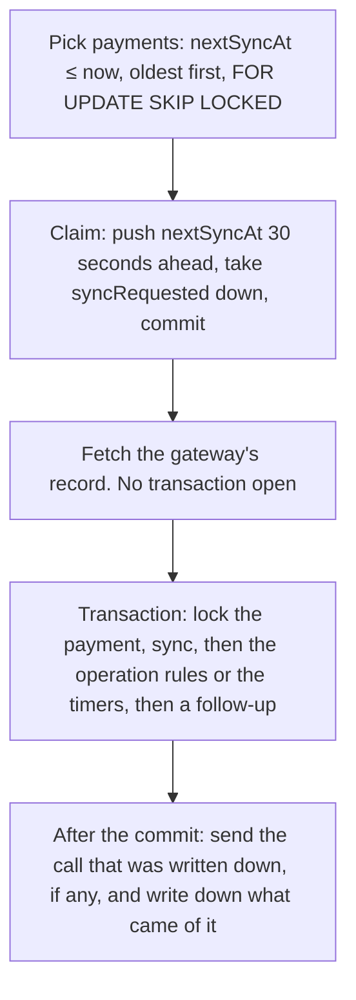

# Webhooks in and the workers

Three workers run inside the service: the **sync worker**, the **matching worker** ([reconciliation](reconciliation.md)) and the **event sender** ([API](api.md#events-sent-to-the-store)). This page covers how a webhook comes in and how the sync worker runs.

## A webhook comes in

`POST /v1/webhooks/card` and `POST /v1/webhooks/pay-later`

| Step | Detail |
|---|---|
| 1. Size | A body over 64 KB is not read: `413` |
| 2. Check | The gateway's secret or signature, compared in constant time. Wrong, missing, or a body that is not JSON: `401`, nothing is saved, and the answer does not say which |
| 3. Read | Only the event id, the event type and the gateway's payment id. Missing: `400`. A gateway that sends no event id (pay later) gets one made from a hash of the body, so the same webhook sent twice is still one event |
| 4. Save | One transaction: insert the event (the event id is unique per gateway); ask for a look at the payment: `nextSyncAt = now` and the flag `syncRequested` |
| 5. Answer | `200`, also for a repeated event and for an unknown payment |

The handler never calls the gateway and never changes a payment's state. It is fast, so the gateway rarely has to retry.

| Case | What happens |
|---|---|
| The same event twice | The insert finds the id. Nothing else happens. `200` |
| Events out of order | No effect: the status in the event is not used |
| An event for a payment Mizan does not have | Saved as unmatched, and one `UNKNOWN_PAYMENT_EVENT` discrepancy is opened per gateway payment id. Someone took a payment at the gateway outside Mizan |
| An event before the create call's answer | The payment row was committed before the call, so it is found |
| An event about a payment whose create answer was lost, at a gateway that chooses its own ids (pay later) | The event carries Mizan's payment id as the provider's order reference. Mizan saves the provider's id on that payment, if it has none yet and is of that gateway. Now Mizan can ask about it |
| A forged event with the right secret | Mizan fetches the real record from the gateway. Nothing false is saved |
| A flood of events | The request limit applies. Extra syncs of the same payment are merged: `nextSyncAt` is one value |

## The customer comes back

`GET /v1/return/{paymentId}`

The gateway sends the customer here after the bank's page. Mizan ignores every query parameter the gateway added: they pass through the customer's browser and can be changed.

1. Look at the gateway once (a sync). If the payment was synced in the last two seconds, skip this step. If the look fails, go on all the same.
2. Answer `303 See Other` to the payment's `returnUrl` with `payment_id` added. The store then reads the payment through the API.

The return page only looks. It starts no follow-up and decides no timer; that is the worker's job, and the worker is due at once if anything waits.

An unknown id, and a payment made without a return address (Apple Pay), give `404`. The endpoint needs no API key and reveals nothing: it only redirects to a URL the store gave. The two-second rule keeps a stranger from using it to flood the gateway with fetches.

## The sync worker

Every second it takes a batch of payments whose `nextSyncAt` has passed.

The claim in the second step is a lease. If the worker dies after it, the payment comes back after 30 seconds. Two instances never fetch the same payment at the same time, and if they did, sync is safe to repeat. A payment that a request holds right now is skipped, not waited for: it is taken in the next round.

What the step decides, on the fresh record, in this order:

| Case | What happens |
|---|---|
| The fetch failed | Nothing is decided on old facts. The failure is counted; the next look follows the back-off |
| An operation is in flight | The [operation rules](payments.md#when-the-result-is-not-known): wait, send once more, or end it without effect. Timers wait until it is settled (rule R4) |
| No operation in flight | The timers: a pending payment or a hold whose time is over ends |
| A follow-up waits | It is started at once, in the same step. If it no longer applies (the money went back in another way, the hold is gone), it is dropped and not counted as started |

`POST /v1/payments/{id}/sync` runs this same step for one payment, now. Tests use it, and so can a person who wants an answer at once.

### A request for a look is never lost

A webhook may come while a look is already on its way to the gateway. That look's record may be older than the news, so it must not answer the webhook.

| Step | Rule |
|---|---|
| A webhook asks for a look | `syncRequested = true` and `nextSyncAt = now` |
| Any save of the payment | While `syncRequested` is up, `nextSyncAt` stays now, whatever the look found |
| The step claims the payment | It takes `syncRequested` down **before** its fetch. Its look started after every request so far, so it answers them. This happens in one place only: the step itself, for the worker and for `/sync` |

The return page looks without the step, so it does not take the flag down. One look too many is safe; one too few is not.

### When a payment is looked at next

| Payment | `nextSyncAt` |
|---|---|
| `PENDING`, waiting for the customer | 15 s, 30 s, 1 min, 2 min, then every 5 min, until `expiresAt`. Then once more, and `expirePending` |
| Any payment with an operation in flight | One quiet minute after the operation's last call. Then every 30 seconds while the gateway cannot be asked |
| `AUTHORIZED` | At `holdEndsAt` |
| A follow-up is waiting | Now |
| `CAPTURED`, `FAILED`, `CANCELED`, `EXPIRED`, nothing waiting | Empty. A webhook or reconciliation sets it when there is news |
| A fetch failed | 30 s, then doubling up to 10 min |

### Times

| Setting | Default | Meaning |
|---|---|---|
| Waiting time for a card payment | 30 minutes | How long a customer may take on the bank's page |
| Waiting time for a pay-later payment | 2 hours | How long a customer may take on the provider's page |
| Hold window | 7 days | How long an `AUTHORIZED` payment can be captured. Must be shorter than the scheme's own limit |
| Quiet time before an unknown result is decided | 1 minute | See [payments](payments.md#when-the-result-is-not-known) |

## Tests

| Test | Proves |
|---|---|
| Webhook tests (`WebhookIT`) | Each row of the case table; wrong, missing and almost-right secrets and signatures; a changed body; too large; missing fields; the simulator's webhook faults end to end; a request that comes during a look is kept |
| Return tests (`ReturnIT`) | Query parameters are ignored; a changed `status=paid` in the address changes nothing; unknown id; the two-second rule |
| Worker tests (`WorkerIT`, `ExpiryIT`, `FollowUpIT`, `UnknownResultIT`) | A dropped webhook is covered by the timer; a late customer becomes a late capture and is refunded; a leaving customer expires; the quiet minute; a capture sent once more, a card refund never |
| Crash tests (`CrashIT`) | A process that dies after transaction 1, before or after its call reached the gateway |
| Lease tests | A worker that dies after the claim; two workers at once; a payment held by a request is skipped |
| Schedule tests | Each row of the `nextSyncAt` table |
| Timer test (`SyncWorkerIT`) | With the workers on, the timer runs rounds by itself |
