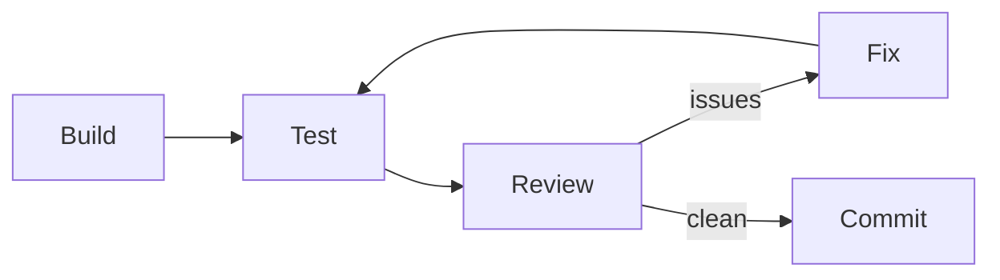
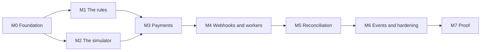

# Build plan

Mizan is built in milestones. Each milestone ends with software that works, is tested and is reviewed. The current state is in [STATUS.md](STATUS.md).

## The loop

Every component inside a milestone goes through the same loop (see [CONTRIBUTING.md](../../CONTRIBUTING.md#how-work-is-done)):

A review has two parts. First the checklist. Then **deliberate bugs**: a bug is planted in the new code, the tests must fail, the bug is removed. A bug that no test catches is a missing test.

A milestone is **done** when all of these are true:

- Every item in its "Done when" list works.
- `./mvnw verify` passes from a clean checkout.
- The review notes are in `docs/reviews/` and every finding is fixed or explained.
- The docs match the code.
- `STATUS.md` is updated.

## Milestones

### M0 — Foundation

| Build | Done when |
|---|---|
| The Maven build with four modules | `./mvnw verify` passes |
| Layer tests (ArchUnit) | A class of `mizan-core` that uses Spring fails the build; an adapter that is used by the application layer fails the build |
| A docs check | A broken link or a diagram that does not start with a known type fails the build |
| CI | The build runs on every push |

### M1 — The rules (`mizan-core`)

| Build | Done when |
|---|---|
| `Money` | Cannot hold a fraction or a negative; adds and compares; refuses another currency |
| The payment, its states, the snapshot | As in [payments](../lld/payments.md) |
| `sync`, the timers | Every cell of the tables in [sync](../lld/sync.md); properties P1 to P7 |
| Operation rules | The table of [unknown results](../lld/payments.md#when-the-result-is-not-known); old snapshots are ignored |
| Ledger entries | Every kind balances; invariant I1 as a property |
| Fees | The formula, with rounding cases |
| Settlement matching | Every branch of [matching](../lld/reconciliation.md#step-2--match-each-line) |
| Coverage | At least 95% of lines in `mizan-core` |

### M2 — The simulator

| Build | Done when |
|---|---|
| The card gateway | Tokens, create with a given id (once), the bank's page, fetch, capture, void, refund |
| The pay-later provider | Session, the provider's page, fetch, capture, close, refund |
| Webhooks | Sent with the secret or the signature; retried on failure |
| The simulator's own book | What was really held, taken and given back, per payment |
| Faults | Every row of the [fault table](../lld/gateways.md#faults) |
| Settlement files and their faults | Every row of the [settlement fault table](../lld/reconciliation.md#settlement-faults) |
| The control API and a clock that can be moved | Tests control time |

### M3 — Payments

| Build | Done when |
|---|---|
| The database schema | Every rule of ["the database enforces"](../lld/data.md#rules-the-database-enforces-itself) is tested by trying to break it |
| API keys and scopes | `401`, `403`; keys are made by a command |
| The gateway adapters | Every result kind; normalizing |
| Create, read, list | Every answer of the [create table](../lld/payments.md#create) |
| One order, one payment | Every row of [its table](../lld/payments.md#one-order-one-payment-that-counts) |
| Idempotency | Every row of the [idempotency table](../lld/api.md#idempotency) |
| Capture, cancel, refund | Every rule and refusal |
| The ledger in the database | Entries in the same transaction; invariants I1 to I3 after every flow |
| Unknown results, without the worker | A lost answer is found by a fetch; nobody is charged twice |

### M4 — Webhooks and workers

| Build | Done when |
|---|---|
| Webhooks in | Every row of the [case table](../lld/workers.md#a-webhook-comes-in) |
| The customer's return | Query parameters are ignored |
| The sync worker and its schedule | Leases; two workers; every row of the schedule |
| Operations with no result | The quiet minute; a capture is sent again once; a create and a card refund never are; `no_effect` |
| Expiry | Pending and hold timers, on fresh facts only |
| Late capture and late hold | Recorded, told, returned; once |
| Follow-ups | Automatic capture for pay later |

### M5 — Reconciliation

| Build | Done when |
|---|---|
| The file parser | Every refusal; a 200,000-line file is read as a stream |
| Import | The same file twice; another file with the same payout id |
| The matching worker | Every branch; the sync before giving up; a crash in the middle continues |
| Suspense and discrepancies | Every type; retry, accept, closing by itself |
| The daily check | Missing from settlement |
| The ledger and reconciliation reports | Invariants I1 to I5 |

### M6 — Events and hardening

| Build | Done when |
|---|---|
| The outbox and the event sender | Signature, retry times, repeats, a slow store, redeliver |
| Limits | Requests per key, body size, `Retry-After` |
| Logs | No token and no secret in the output of a full flow |
| Metrics and health | Each metric moves |
| The API description | Served, and checked against the controllers |
| Docker | `docker compose up` starts the database, the simulator and Mizan |
| Clean-up job | Old keys and events are deleted |

### M7 — Proof

| Build | Done when |
|---|---|
| The proof run | A seeded plan of payments and faults; the comparison with the simulator's book; a report |
| The real gateway adapter | Built from the public documents; skipped without keys, and says so |
| The demo | A script that shows the main flows, with its output saved |
| The interview page | The project explained in one page: the business, the seven rules, the questions and answers |
| The final review | Every "done when" line checked; every design claim checked against the code |
